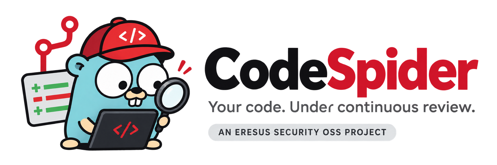
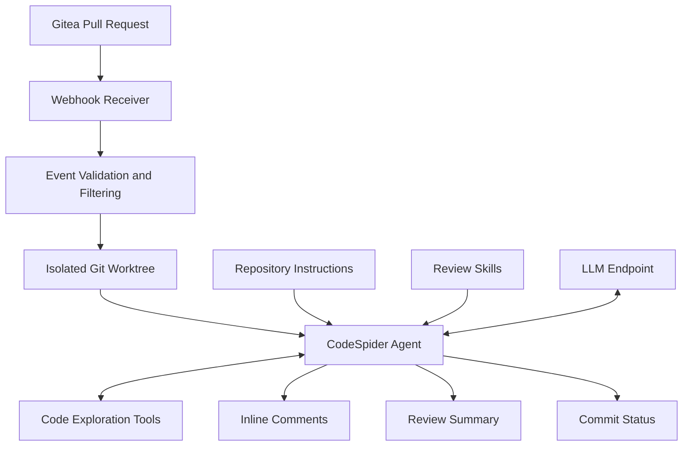

<div align="center">

  

  <h3>Self-hosted. Agentic. Always reviewing.</h3>

  <p>
    An autonomous, 24/7 pull request reviewer for Gitea.<br />
    Built with Go. Powered by your preferred LLM.
  </p>

  [](https://go.dev/)
  [](https://gitea.com/)
  [](https://www.docker.com/)
  [](LICENSE)
  [](#quick-start)

  [Getting Started](#quick-start) ·
  [Features](#features) ·
  [Architecture](docs/architecture.md) ·
  [Configuration](docs/configuration.md)

</div>

---

## What is CodeSpider?

CodeSpider is a lightweight, self-hostable daemon that brings
continuous, agentic code review to your Gitea instance.

Unlike simple diff-based reviewers, CodeSpider explores the
surrounding codebase, follows repository-specific instructions,
and investigates changes before posting actionable feedback.

Run it on your own infrastructure, connect your preferred LLM,
and let it review pull requests around the clock.

## Why CodeSpider?

- **Agentic by design** — Explores the codebase beyond the diff.
- **Self-hosted** — Run on infrastructure you control.
- **Model agnostic** — Bring your own OpenAI-compatible LLM.
- **Repository aware** — Respects project-specific instructions.
- **Always available** — Event-driven reviews, 24/7.
- **Lightweight** — Built with Go and distributed as a container
  or standalone executable.

## How It Works



## Features

| Feature | Description |
| :--- | :--- |
| **Continuous Reviews** | Automatically reviews new and updated pull requests. |
| **Agentic Exploration** | Inspects diffs, reads files, searches code, and examines PR comments. |
| **Interactive Replies** | Mention `@codespider` to ask questions directly in PR threads. |
| **Review Skills** | Extensible `SKILL.md` modules for specialized reviews. |
| **Repository Instructions** | Supports repository-native review policies and configuration. |
| **One-Click Suggestions** | Posts Gitea suggestion blocks for actionable fixes. |
| **Smart Filtering** | Skips drafts, bot-authored PRs, and ignored paths. |
| **Optional Write Mode** | Allows the agent to edit files, commit, and push changes. |
| **LLM Flexibility** | Supports any compatible chat completions endpoint with tool calling. |
| **Execution Guardrails** | Deduplication, cancellation, token budgets, and step limits. |
| **Observability** | Dedicated health, readiness, and status endpoints. |

## Review Skills

CodeSpider ships with built-in review skills that guide the
agent's investigation.

| Skill | Focus |
| :--- | :--- |
| [Security](skills/security/SKILL.md) | Security vulnerabilities and unsafe implementation patterns. |
| [Code Quality](skills/code-quality/SKILL.md) | Maintainability, correctness, and implementation quality. |
| [Testing](skills/testing/SKILL.md) | Test coverage, missing test cases, and regression risks. |

Skills can be combined with repository-specific instructions:

```text
AGENTS.md
.gitea/review-instructions.md
.codespider/instructions.md
.codespider.yaml
```

## LLM Compatibility

CodeSpider works with OpenAI-compatible endpoints that support
tool calling.

| Provider | Supported |
| :--- | :---: |
| OpenAI | Yes |
| OpenRouter | Yes |
| vLLM | Yes |
| LiteLLM | Yes |
| Custom OpenAI-compatible endpoint | Yes |

Use a hosted provider or deploy a model on your own infrastructure.

## Quick Start

### Docker Compose

The recommended deployment method for production.

```bash
cp codespider.example.yaml codespider.yaml

# Configure your Gitea instance, webhook secret,
# and preferred LLM endpoint.

docker compose up -d
```

The production configuration uses:

```text
ghcr.io/eresus-security-oss/codespider:latest
```

The container uses a Distroless Debian 13 runtime.

### Build from Source

```bash
cp codespider.example.yaml codespider.yaml

go build -o codespider ./cmd/codespider

./codespider -f codespider.yaml
```

Alternatively, specify the configuration path using:

```bash
export CODESPIDER_CONFIG_PATH=/path/to/codespider.yaml

./codespider
```

### Local Development

```bash
DOCKER_BUILDKIT=1 docker compose \
  -f docker-compose.dev.yaml up -d --build
```

## HTTP Endpoints

| Method | Endpoint | Purpose |
| :--- | :--- | :--- |
| POST | `/webhook` | Receives Gitea webhook events. |
| GET | `/healthz` | Process health. |
| GET | `/readyz` | Service readiness. |
| GET | `/status` | Service status. |

Webhook requests are authenticated using HMAC-SHA256
verification through `X-Gitea-Signature`.

## Security & Guardrails

CodeSpider includes safeguards for continuous operation:

- HMAC-SHA256 webhook verification.
- Isolated Git worktrees.
- Reviewed commit SHA deduplication.
- Cancellation of superseded reviews.
- Agent step and token budgets.
- Duplicate tool-call limits.
- Bot reply loop protection.
- Path traversal and `.git/` access protection
  for write operations.
- Explicit opt-in for agent write access.

Write operations are available only when explicitly enabled:

```text
AGENT_ENABLE_WRITE=true
```

When enabled, the agent can use:

- `write_file`
- `edit_file`
- `commit_and_push`

## Agent Tools

| Tool | Purpose |
| :--- | :--- |
| `get_pr_diff` | Inspect pull request changes. |
| `read_file` | Read surrounding source code. |
| `search_code` | Search the checked-out codebase. |
| `list_pr_comments` | Retrieve existing review discussions. |
| `write_file` | Write files in opt-in write mode. |
| `edit_file` | Edit files in opt-in write mode. |
| `commit_and_push` | Commit and push changes in opt-in write mode. |

## Documentation

- [Architecture](docs/architecture.md)
- [Gitea Setup Guide](docs/gitea-setup.md)
- [Configuration Reference](docs/configuration.md)

## Development

```bash
go build ./...
go vet ./...
go test -v ./...
```

## Contributing

Contributions, bug reports, feature requests, and new review
skills are welcome.

Please review [AGENTS.md](AGENTS.md) before making changes.

## License

CodeSpider is licensed under the
[Apache License 2.0](LICENSE).

The CodeSpider mascot is inspired by the Go Gopher,
originally designed by Renée French and licensed under
Creative Commons Attribution 3.0.

---

<div align="center">

  <b>An Eresus Security OSS Project</b>

  <br /><br />

  <a href="https://eresussec.com">Website</a> ·
  <a href="https://github.com/Eresus-Security-OSS">GitHub</a>

  <br /><br />

  Your code. Under continuous review.

</div>
